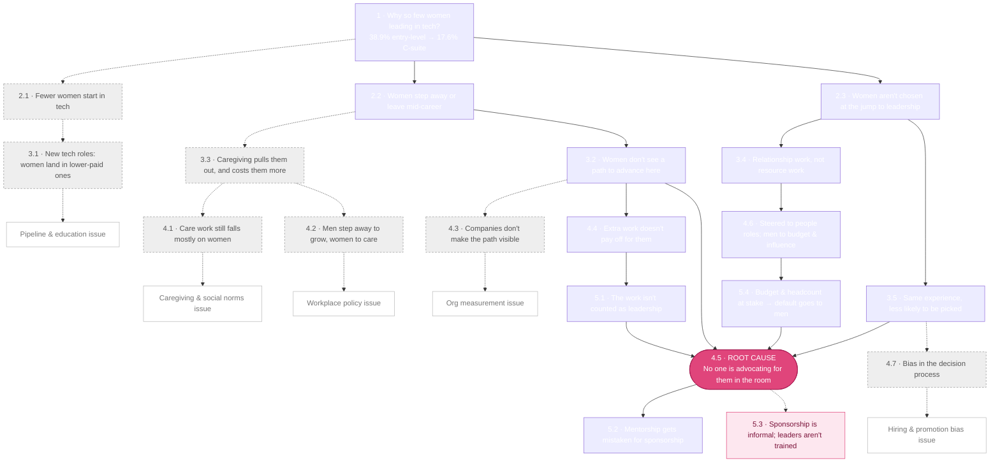

# 🌳 Why are there so few women leading in tech?

## ☕ The tea

Girl, it's not a skills problem. Zoe asked "why?" five times and kept landing in the same place: **no one is advocating for women in the room** (4.5). Three separate paths lead there: the work women do doesn't get counted, they get handed relationship work instead of resource work, and even with the same experience they aren't picked.

## The tree

Solid lines are on the path to the root cause. Dotted lines are branches Zoe ruled **out of scope** for this talk. They're kept here on purpose, because they're still real.

## 🧭 Where each branch lives in the brain

| Node | Branch | Page |
|---|---|---|
| 4.5, 5.2, 5.3 | Root cause: sponsorship | [[sponsorship-gap]] |
| 3.2 → 4.4 → 5.1 | Evidence gap | [[evidence-gap]] |
| 2.3 → 3.4 → 4.6 → 5.4 | Exposure gap | [[exposure-gap]] |
| 3.5, 4.7 | Hiring & promotion bias | [[hiring-and-promotion-bias]] |
| 2.1, 3.1 | Pipeline & education *(out of scope)* | [[pipeline-and-education]] |
| 3.3, 4.1 | Caregiving & social norms *(out of scope)* | [[caregiving-and-social-norms]] |
| 4.2 | Workplace policy *(out of scope)* | [[workplace-policy]] |
| 4.3 | Organizational measurement *(out of scope)* | [[organizational-measurement]] |

## 🧾 Receipts

See the node pages above. Every number on the tree comes from [[wef-global-gender-gap-2026]] or [[toast-gender-equity-2026]], as recorded on [[zoe-wwc-board-2026]].
⚠️ The numbers were copied from Zoe's board and haven't yet been checked against the original reports. See [[lint-report]].

## 🎨 From the original research

> "Skill gap that leadership thinks it's seeing is actually an exposure gap."
> "A small change we can do is to become sponsors for our kind."
> ([[zoe-wwc-board-2026]])

## 💭 Still brewing

- The **solution side** of the tree is thin. 5.3 ("Formalize sponsorship. Train it like a skill.") is the only node about the company's role. What else belongs there?
- The why chain still doesn't explain why fewer women study STEM in the first place (Zoe flagged this herself on 2.1).
- Proposed branches will appear here as new sources get ingested.

## ☕ Who's at the table

| Node | Guests |
|---|---|
| 2.1 pipeline | [[reshma-saujani\|Reshma Saujani]] |
| 4.4 → 5.1 evidence gap | [[tanya-reilly\|Tanya Reilly]] |
| 4.5 root cause | [[herminia-ibarra\|Herminia Ibarra]], [[lara-hogan\|Lara Hogan]] · case study: [[anita-borg\|Anita Borg]] |
| 5.2 mentorship ≠ sponsorship | [[herminia-ibarra\|Herminia Ibarra]], [[lara-hogan\|Lara Hogan]] |
| 5.3 sponsorship is informal | [[lara-hogan\|Lara Hogan]] |

The full library is at [[the-tea-party]]. Women used as examples (pioneers and others) are in [[case-studies]].

## 🔗 Connected tea

[[triple-threat-framework]] · [[three-kinds-of-gaps]] · [[wwc-nyc-2026-talk]] · [[mentor-coach-sponsor]]
