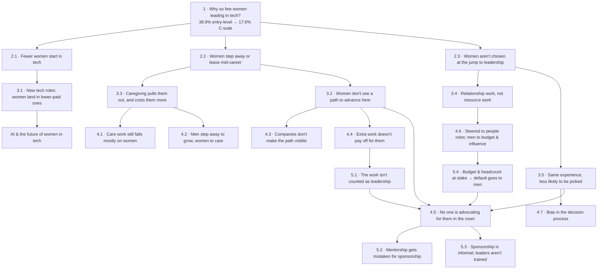

# 🌳 Where it started: the Five Whys tree

## ☕ The tea

Girl, this is where the brain was born. Zoe's original research asked one question, **why are there so few women leading in tech?**, and kept asking "why?" Each branch below is a part of the answer, and each one grew into a theme in this brain. The brain has kept growing past the tree since then. New themes don't need a node to belong here.

## The tree

## 🧭 Where each branch lives in the brain

| Node | Theme |
|---|---|
| 2.1 | [[pipeline-and-education]] |
| 3.1 | [[ai-and-the-future-of-women-in-tech]] |
| 3.3, 4.1 | [[caregiving-and-social-norms]] |
| 4.2 | [[workplace-policy]] |
| 4.3 | [[organizational-measurement]] |
| 3.2 → 4.4 → 5.1 | [[evidence-gap]] |
| 2.3 → 3.4 → 4.6 → 5.4 | [[exposure-gap]] |
| 3.5, 4.7 | [[hiring-and-promotion-bias]] |
| 4.5, 5.2, 5.3 | [[sponsorship-gap]] |

## 🧾 Receipts

Each theme page holds its own receipts. Every number on the tree comes from [[wef-global-gender-gap-2026]] or [[toast-gender-equity-2026]], as recorded in [[zoe-research-notes]].
⚠️ The numbers were copied from the original research and haven't been checked against the reports yet. See [[lint-report]].

## 🎨 From the original research

> "Skill gap that leadership thinks it's seeing is actually an exposure gap."
> "A small change we can do is to become sponsors for our kind."
> ([[zoe-research-notes]])

## 💭 Still brewing

- The **solution side** is thin. 5.3 ("Formalize sponsorship. Train it like a skill.") is the only node about the company's role. What else belongs there?
- The tree still doesn't explain why fewer women study STEM in the first place (the original research flagged this on 2.1).
- New themes the brain learns don't have to hang off a node. When one does, it gets added here.

## ☕ Who's at the table

| Node | Women |
|---|---|
| 2.1 | [[reshma-saujani\|Reshma Saujani]] · [[brenda-darden-wilkerson\|Brenda Darden Wilkerson]] · [[lissa-matyas\|Lissa Matyas]] |
| 4.4 → 5.1 | [[tanya-reilly\|Tanya Reilly]] |
| 4.5 | [[lara-hogan\|Lara Hogan]] · case studies: [[herminia-ibarra\|Herminia Ibarra]], [[anita-borg\|Anita Borg]] |
| 5.2 | [[lara-hogan\|Lara Hogan]] · case study: [[herminia-ibarra\|Herminia Ibarra]] · [[brenda-darden-wilkerson\|Brenda Darden Wilkerson]] |
| 5.3 | [[lara-hogan\|Lara Hogan]] |

The full library is at [[the-tea-party]]. Women used as examples (pioneers and others) are in [[case-studies]].

## 🔗 Connected tea

[[triple-threat-framework]] · [[three-kinds-of-gaps]] · [[mentor-coach-sponsor]]
